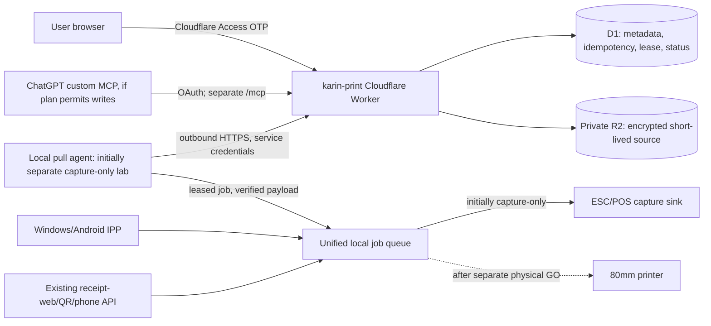

# Cloudflare Print + ChatGPT 印刷連携：追加設計 (2026-10-25)

## 目的と現況
従来のWindows/Android IPP、既存Web/QR/電話イベント印刷を**維持**したまま、Cloudflare Workers上の個人用印刷フロントを追加する。ChatGPTからは、認可されたMCPツールを使ってジョブ準備・本人確認・印刷確定できることを目標とする。

既存 `generic-ipp-gateway/` はloopback capture-only。実機プリンタ出力・本番CT363変更は引き続きNO-GO。今回の設計追加はデプロイや物理送信の証拠ではない。

## 構成図

No inbound Cloudflare Tunnel is needed for the initial pull design. Local agent uses only egress HTTPS and does not expose printer TCP/9100. Production routing is a separate, gated phase; do not alter the existing receipt-web RAW TCP route now.

## Cloudflare frontend
- Worker service logical name `karin-print`, no invented production domain or configured credentials. Reuse GitHub->Cloudflare deployment conventions after checking existing monorepo/repo ownership.
- Static responsive UI: paste text, limited Markdown, PDF/image upload, 80mm preview, print copies forced to 1 by default, job history/status. Do not promise perfect PDF layout before rendering test.
- Browser authorization: existing Cloudflare Access email OTP policy (or explicit equivalent), **validate identity at Worker**, not merely client-supplied headers. CSRF protections on cookie-based mutations; origin/cookie settings and rate limits.
- MCP: separate `/mcp` endpoint with explicit OAuth/OIDC flow and scopes. Do **not** assume the Access OTP browser cookie authenticates a ChatGPT MCP client. Use documented remote MCP authorization and no anonymous print tools.
- MCP tools: `prepare_print({content,format,title?})` (creates draft + returns preview/status), `confirm_print({draft_id,approval_token})` (write side effect, requires explicit in-conversation user confirmation and tool-level confirmation), `get_print_status({job_id})`, `cancel_queued_print({job_id})`. Reject arbitrary URLs, arbitrary ESC/POS, scripts, printer-target overrides, and unsigned approval tokens.
- ChatGPT product support check: full write-capable custom MCP availability is plan/account/workspace dependent (OpenAI help center as of 2026-10-25 describes write-enabled full MCP beta for Business/Enterprise/Edu). On unsupported plans the browser UI remains the supported path. API-integrated MCP is an alternative only when separately configured, not a claim of ChatGPT direct printing.

## Job model (fail closed)
State graph:
`draft -> awaiting_confirmation -> queued -> leased -> capture_completed -> printed/unknown`.
`queued -> cancelled`; `leased -> uncertain` when local acceptance or output status is unknowable. Physical print status is **never inferred** from TCP sendall, nor from Cloudflare enqueue completion.

- Two explicit phases for remote print submission: preview and authorized confirmation. Browser and MCP share the exact same job API and authorization.
- Durable metadata in D1, source bytes in private R2 with short expiration and cleanup; no public R2 URLs. Limit payload type/size/pages, validate PDF/images/UTF-8 at the receiver, reject unsafe formats.
- Each operation carries `job_id` and client idempotency key. Cloud-side status transitions must be compare-and-swap/transactional; one lease owner, TTL, no duplicate claim. Retry of **not-yet-dispatched** jobs can be safe after lease expiry only if receiver ledger proves there was no printer/capture dispatch; otherwise `uncertain` and manual resolution.
- Local agent records claim/attempt/ack in durable journal before handing job to queue. Capture-only replays in mock tests permitted; **physical output must never auto-retry** after possible partial send. Do not confuse request accepted, queued, captured, physically printed.
- Unified **one physical spool** owns all sources: Cloudflare, Windows/Android IPP, legacy Web/QR/phone. Existing direct RAW connections have worker-level cross-process race; do not claim physical exclusion until they are actually migrated behind one queue.
- Enforce tenant/user scope, quotas, bounded pending jobs, retention and purge. Avoid content, phone numbers, tokens, or personal data in logs. Use least privilege Worker bindings and service secrets.

## Implementation tracks, in order
1. Offline `cloudflare-print/` Worker project, responsive UI, HTTP API + mock MCP tool surface, D1 migrations and R2 storage adapter. Do not deploy to a public domain with print writes enabled.
2. Offline separate pull-agent simulator and capture-only unified-queue adapter; run mock Cloudflare runtime/local tests. No CT363, no printer IP, no Cloudflare account secrets in GitHub.
3. Security + failure suite: unauthorized user, wrong scopes, CSRF, malformed/multistep IPP equivalents, payload limits, invalid PDF/image, two identical submits, expired lease, concurrent workers, lost ack, local restart, offline gateway, API 429/5xx, R2 purge, cancellation before/after claim, backend crashes, silent nonresponse. Verify **zero accidental physical sends**.
4. Cloudflare Access/OAuth configuration and staging Worker: confirm with account owner, bind D1/R2 and secret values outside Git. Allow user to browse preview and confirm a job that is delivered **only to a capture sink**.
5. MCP ChatGPT integration: test oauth discovery and write-tool availability on the actual account; if unavailable, document web fallback and avoid announcing ChatGPT direct-write capability.
6. Separate physical GO gate: exact printer model/media/cut/feed/ACK, backup and rollback, a single approved maintenance window, CT363 migration to one physical queue. No physical job before these are met.

## Definition of done (offline)
- Web preview/confirm/list/cancel and mock MCP prepare/confirm/status work under tests.
- D1 uniqueness, R2 private objects, TTL cleanup and lease atomicity are tested.
- Local agent polls mock API outbound, authenticates, and delivers one job to **capture-only** queue; no physical transport.
- Existing `generic-ipp-gateway/` regression tests remain green.
- CI includes auth, concurrency, injection, crash/restart, idempotency and no-egress guards.
- README documents setup, mock capture demonstration, security/plan constraints, GO/NO-GO.
- GitHub commit and Draft PR. *CI pass is not end-to-end physical printing proof.*

## External documentation
- Cloudflare Workers / Access secure MCP servers: https://developers.cloudflare.com/cloudflare-one/access-controls/ai-controls/secure-mcp-servers/
- ChatGPT custom MCP server plugin: https://developers.openai.com/api/docs/guides/custom-mcp-server
- ChatGPT connection and plan restrictions: https://help.openai.com/en/articles/12584461-connecting-custom-mcp-servers-in-chatgpt
