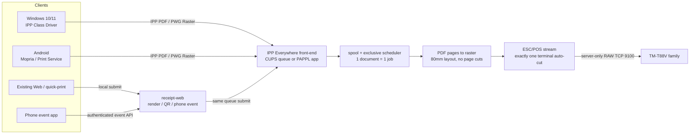

# 推奨アーキテクチャ

## 推奨方式: 単一IPP queueとESC/POS出力worker

Debian 13上のIPP Everywhere front-endと単一spool/job schedulerを配置する。CUPS custom queueまたはPAPPL Printer ApplicationをPhase 0の隔離PoCで選ぶ。IPPはPDF/PWG Rasterを受け、server filterが80mm roll用幅へnormalizeし、同じ文書の全ページをcutなしで連続送信する。成功した最終データの後にauto-cutを一度だけ送る。既存Web/quick-print/phone eventも同じqueueへlocal submitし、プリンタへの直接9100接続をなくす。

## Job/cut correctness contract

1. 1 IPP job maps to 1 document. All pages are accepted/spooled before emission where practical, so later page conversion errors do not leave a normally completed receipt.
2. Scheduler owns exclusive access from first byte through job finalization; other documents cannot interleave.
3. Page filters must not output cut commands. A single finalizer owns the only auto-cut opcode for each successful document.
4. Send page content and required final paper feed. Send one selected full/partial cut only after normal conversion and successful write of the complete print stream.
5. If connection fails after any bytes may have been accepted, mark job uncertain/failed; do not send cut and do not automatically replay full document. Printer status/query or operator recovery is needed to avoid duplicate output.
6. TCP write completion does not prove physical printing completed. True “normal finish” semantics need printer status response or a carefully defined server-side acceptance boundary. This is a design risk because RAW TCP may not provide reliable job acknowledgment.
7. Test that CUPS filters, backend, and any printer-specific options never inject their own page-level cuts.

## なぜこの構成か

- Windows/Android標準IPPに乗せられる。
- ESC/POS固有のpaper feed/cutと80mm幅変換をサーバに閉じ込める。
- Web印刷とOS印刷を一つのspool queueで排他できる。
- 現在のphone-event API/画面は保ち、内部submission経路だけ統一できる。
- PAPPLはIPP Everywhere/DNS-SD frameworkだが、ESC/POS driverは別途必要。[OpenPrinting](https://openprinting.github.io/upcoming-technologies/01-printer-application) [PAPPL](https://github.com/michaelrsweet/pappl)

## 代替

1. **CUPS custom filter**: 実装を小さく始めやすい。IPP clientからのformat/capability表示と共有発見を重点実証する。
2. **PAPPL native Printer Application**: IPP属性・discovery制御をしやすいがfilter/job lifecycleを実装する。
3. **Epson APD on Windows**: Windowsのみのfallback。APDでは文書終端一回cutを含む連続roll動作を実証する。
4. **専用Android PrintService**: Mopria interop不成立時の追加開発。標準IPP経路より端末ごとのAPK管理が増える。

## 導入候補（今回未導入）

- Debian CUPS daemon/client、filter tools
- Avahi daemon / DNS-SD
- PDF rendererおよびPWG Raster decoder
- 80mm layout + raster-to-ESC/POS filter/encoder（既製の保守済み適合実装を特定できていない）
- PAPPL + native applicationを選んだ場合は開発依存
- Web appから同じqueueへ送るローカルIPPs/IPP clientまたは専用adapter

## Network / security

- IPP TCP/631は信頼LAN限定。必要時はIPPS/TLS、証明書信頼とclient ACL。
- Avahi UDP/5353はlocal link discovery。subnet/VLAN/VPN越しに自然に転送されると想定しない。
- 管理UIはloopback/管理networkのみ。CUPS管理権限と印刷権限を分離。
- RAW TCP 9100はserver→printerのみ。LAN client/WANから遮断。
- TailscaleではACLとtailnet hostname/IPPSを優先し、mDNS relayを必須にしない。
- インターネットへ無認証公開しない。phone event API tokenは既存の認証制御とし値を文書/logに残さない。

## 検証課題

- Epson資料の通常TM-T88V 80mm印字可能幅72mm/512 dots。[Epson guide](https://files.support.epson.com/pdf/pos/bulk/tm-t88v_trg_en_revf.pdf) 完全なsuffix/firmware/interfaceと実media設定を確認。
- 80mm mediaだけを広告しA4/58mmを拒否する。
- native width/scale/margins、PDF page resizeと連結、orientation、large job memory、font license、Japanese glyph、image tone、QR integrity。
- feed amountとfull/partial cutの仕様を正確なmodel guideで確認。最終feed/cut locationを実測。
- normal finish判定、error後cut suppression、partial write時のduplicate handling、status acknowledgment。
- 全filterでpage-level cut opcodeを無効化。完成streamに文書当たり一つだけterminal cutがあることをオフライン解析/後に専用試験で確認。
- 512MiB RAM/1 vCPU内のPDF負荷、spool retention/capacity。
