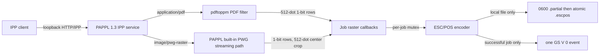

# Architecture

The custom PAPPL device scheme is exactly `capture://local`. Its open callback accepts only that URI, its close callback is a no-op, and its device-write callback always returns `-1`. The print callbacks write through `capture.c` using an `openat` directory descriptor; they do not call `papplDeviceWrite`.

The PDF filter invokes `/usr/bin/pdftoppm` with an argv array (no shell), a 30-second CPU limit, a 768 MiB address-space limit, a 64 MiB per-file size limit, at most 201 output pages for detection, and 512-dot output width. It reads one PGM row at a time and packs it to one-bit black pixels. Full Poppler sandboxing is not provided.

PAPPL's special PWG Raster streaming path does not call the registered MIME filter. It calls the raster driver callbacks directly. The driver emits 512 dots by center cropping the callback row. PAPPL's output header uses the queue's 200 mm media length, so the PWG path can add blank rows per page. It remains useful for protocol/capture testing, but it is not yet suitable for continuous-document output.

An exclusive mutex protects a whole capture job. The encoder emits one `GS v 0` raster header per page and emits no page feed or cut command. The job end callback appends one full-cut `GS V 0` only if all callbacks succeeded and at least one page completed. `capture_finish` fsyncs, renames the temporary file, then writes a structured event. Failures remove partial data and do not produce a completed event.

The capture directory is required to be absolute, owned by the effective user, a real directory (not a symlink), and have no group/world permissions. A 64 MiB ESC/POS job limit is enforced. A process restart never promotes `.partial` files.
