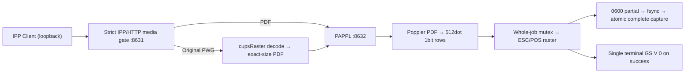

# Architecture (capture-only)

The strict front end validates original IPP `media` and nested `media-col` before PAPPL can normalize unsupported media, rejects unsupported state-changing operations, accepts bounded HTTP chunked/Content-Length framing, and forwards through **127.0.0.1 only**. Backend PAPPL is on a different loopback port. The raw backend is a trusted local implementation detail, **not protected from other local processes**.

PAPPL 1.3 streams PWG directly and normalizes page height to the default 200mm media. Thus a driver callback cannot re-open the original PWG job file. Instead the front end decodes the source PWG with CUPS raster APIs and writes a multi-page PDF containing an image per page with original height in the MediaBox; the existing Poppler-driven PDF filter rasterizes that. Source white rows remain intact. Constraints: 512 dots, 1bit K/W, <=65535 rows/page, <=200 pages, <=64MiB processed raster per conversion. Unsupported or truncated conversion fails without a completed capture.

Page callbacks write image rows and **do not feed or cut at page boundaries**. The job finalizer alone writes one full-cut command into the capture on success. The capture directory is absolute, user-owned, private and not a symlink; completed files are mode 0600. There is no TCP/9100/USB/serial/remote printer code.

The front end does not yet support Create-Job/Send-Document transactions, Windows/Mopria discovery, TLS, LAN clients, or host-based isolation of the backend port. Security and client interoperability must be resolved before any non-offline rollout.
